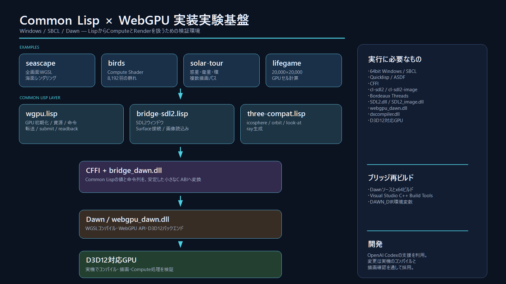

# wgpu for SBCL



このリポジトリは、**Windows上のSBCLからDawnを介してWebGPUを利用するための実装実験基盤**です。Common LispでGPUの初期化、Compute Pipeline、Render Pipeline、バッファ転送、テクスチャ、画面表示を扱い、WGSLシェーダーを使った小規模なアプリケーションを作れる環境を目指しています。

完成した汎用ライブラリではなく、API設計、CFFI境界、Dawnの更新追従、GPU表現を実際のexampleで検証しながら育てているプロジェクトです。開発、調査、移植、デバッグ、ドキュメント整理には**OpenAI Codexの支援**を利用しています。生成・修正されたコードは、実機でのコンパイルと描画確認を行いながら採用しています。

## 構成

- `wgpu.lisp` — Common Lisp向けWebGPU API。GPU初期化、資源生成、Compute/Render命令、転送、submit、readbackを担当します。
- `bridge/bridge_dawn.c` — LispからDawnを呼び出すための小さなC ABIブリッジです。
- `bridge/bridge_dawn.dll` — Windows用にビルドしたブリッジDLLです。
- `bridge-sdl2.lisp` — SDL2ウィンドウからWin32ハンドルを取得し、WebGPU Surfaceへ接続します。画像読込みも提供します。
- `three-compat.lisp` — icosphere、orbitカメラ、look-at基底、ray生成など、Three.jsの一部に対応する純粋な数値処理です。
- `packages.lisp` — 公開パッケージを定義します。
- `wgpu.asd` — `wgpu`、`wgpu/sdl2`、`wgpu/three-compat`のASDF定義です。
- `examples/` — 共通層を実際の描画と計算で検証するプログラムです。

## Examples

| example | 内容 |
|---|---|
| `seascape` | WGSLによるリアルタイムの海面表現です。全画面描画、uniform更新、リサイズ処理を確認できます。 |
| `birds` | 8,192羽の群れをCompute Shaderで更新し、Render Pipelineで描画します。Three.jsのWebGPU birds exampleをCommon Lispへ移植した実験です。 |
| `solar-tour` | 太陽、惑星、衛星、環、軌道、ワープ表現を含む太陽系ツアーです。複数の描画パスと画面効果を検証します。 |
| `lifegame` | 20,000×20,000セルのConway's Game of Lifeです。Compute Shader、間接dispatch、GPUバッファ管理を検証します。 |

各exampleは対応するディレクトリでLispファイルを読み込むと起動します。

```powershell
cd examples\seascape
sbcl --load seascape.lisp

cd ..\birds
sbcl --load birds.lisp

cd ..\solar-tour
sbcl --load solar-tour.lisp

cd ..\lifegame
sbcl --load lifegame.lisp
```

## 実行環境

主な対象環境は64bit Windowsです。

### 必要な処理系とライブラリ

- **SBCL 64bit**
- **Quicklisp**
- **ASDF**
- Common Lispライブラリ
  - `CFFI`
  - `cl-sdl2`
  - `cl-sdl2-image`
  - `Bordeaux Threads`
- ネイティブライブラリ
  - Dawnの`webgpu_dawn.dll`
  - Dawnが使用する`dxcompiler.dll`
  - `SDL2.dll`
  - `SDL2_image.dll`
- D3D12対応GPUと現在のグラフィックスドライバー

Quicklisp管理のLispライブラリは、各ASDFシステムまたはexampleの読み込み時にロードされます。

### PATH

SBCLを起動する前に、次のDLLを検索できるディレクトリをWindowsの`PATH`へ追加します。

- `webgpu_dawn.dll`と`dxcompiler.dll`があるDawnのビルド出力ディレクトリ
- `SDL2.dll`があるディレクトリ
- `SDL2_image.dll`があるディレクトリ

確認例：

```powershell
where.exe webgpu_dawn.dll
where.exe dxcompiler.dll
where.exe SDL2.dll
where.exe SDL2_image.dll
```

`bridge_dawn.dll`はリポジトリ内の`bridge/`から読み込むため、PATHへの追加は不要です。

## ASDFからの読込み

リポジトリのディレクトリをASDFから見える場所へ登録した後、必要な層を読み込みます。

```lisp
(asdf:load-system :wgpu)
(asdf:load-system :wgpu/sdl2)
(asdf:load-system :wgpu/three-compat)
```

`wgpu`はGPU共通層、`wgpu/sdl2`はウィンドウ連携、`wgpu/three-compat`は状態を持たない3D計算です。アプリケーションは必要なシステムだけを利用できます。

## Dawnブリッジのビルド

通常実行ではビルド済みの`bridge/bridge_dawn.dll`を使用します。ブリッジを再ビルドする場合は、次の環境も必要です。

- Dawnのソースとx64 Releaseビルド
- Visual Studio 2026のC++ Build Tools
- x64 Native Tools環境
- 環境変数`DAWN_DIR`（Dawnルートディレクトリ）

Visual Studio Developer Command Promptで実行します。

```bat
set DAWN_DIR=path\to\dawn
bridge\build_dawn.bat
```

ビルドスクリプトはDawnの生成ヘッダーとimport libraryを使って一時DLLを作り、x64であることを確認してから`bridge_dawn.dll`を置き換えます。失敗した場合は既存DLLを保持します。

## 実装上の境界

```text
exampleのLispコード
    ↓
wgpu.lisp / bridge-sdl2.lisp / three-compat.lisp
    ↓ CFFI
bridge_dawn.dll
    ↓ C API
webgpu_dawn.dll
    ↓
D3D12 / GPU
```

WGSLはDawnがコンパイルします。シェーダーの診断結果は各exampleの`*-shader-compile.log`へ記録されます。GPU APIとC ABIの対応は`wgpu.lisp`と`bridge/bridge_dawn.c`の双方で管理しているため、構造体、列挙値、引数の変更時には両側を同時に確認する必要があります。

